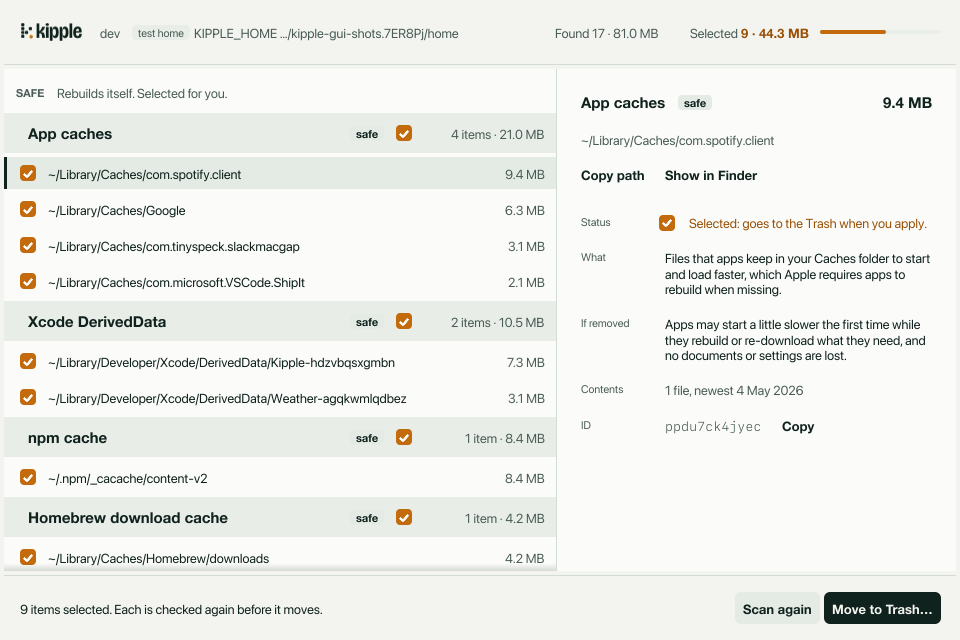
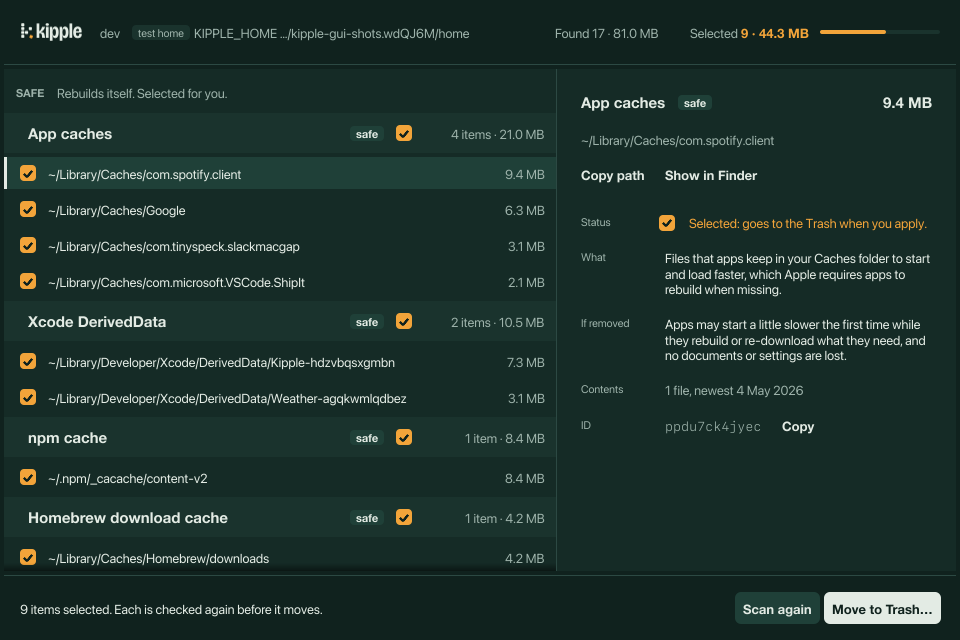

<p align="center"></p>

# kipple

kipple finds the caches, build folders and leftovers that AI coding tools,
local models and developer toolchains pile up in your home folder on macOS
or Linux, explains each one, and moves only what you approve to the Trash.
It is a single MIT-licensed Go binary with a JSON contract that agents can
drive, a terminal UI for people, an optional Mac app, and nothing it does
happens without `--apply` or a confirmation.

- [What it cleans](#what-it-cleans)
- [The safety model](#the-safety-model)
- [Install](#install)
- [Usage](#usage)
- [Linux](#linux)
- [For agents](#for-agents)
- [How it compares](#how-it-compares)
- [Roadmap](#roadmap)
- [Contributing](#contributing) and [licence](#licence)

## What it cleans

kipple knows a fixed catalogue of locations under your home folder
(`kipple rules` lists them all, with a one-sentence "what it is" and "what
happens if it goes" for each). Every rule has a tier:

| Tier | What it means | Examples |
|---|---|---|
| `safe` | Rebuilds itself. Selected by default. | `~/Library/Caches`, `~/Library/Logs`, Xcode DerivedData, simulator caches, Homebrew, npm, pnpm, Yarn, Bun, pip, uv, Poetry, Cargo, Go build, Gradle, CocoaPods and SwiftPM caches, Cursor, VS Code and Windsurf caches, Claude Code shell snapshots and debug logs, Codex logs |
| `review` | Rebuilds, but costs time or needs a condition. Selected with `--level review`. | Go module cache, Xcode device support unused for 90 days, `node_modules`, Rust `target`, Python virtualenvs and `.next` in projects untouched for 30 days whose git state is committed and pushed |
| `manual` | Never selected for you. Moved only when you name the item. | Xcode Archives, the Hugging Face hub cache, Codex worktrees (committed and pushed only), installers in Downloads older than two weeks |
| `info` | Measured and reported, never moved. kipple shows the owner's own command instead. | Ollama models (`ollama rm`), Docker's disk image, Claude Code and Codex session history, simulator runtimes |

The table shows the macOS catalogue. On Linux the Xcode, simulator and
`~/Library` rules do not exist, and these come in: other apps' caches in
`~/.cache` untouched for a week (`safe`), JetBrains IDE caches, the Maven
repository and Flatpak app caches (`review`), downloaded AI models
(`manual`), and rootless Docker, Podman, Flatpak and Snap data (`info`). The
tool caches (npm, pip, Cargo, Go and the rest) are found where each tool
keeps them on Linux. `kipple rules` lists the catalogue of the system it
runs on.

## The safety model

kipple is built so that the failure mode is "it refused to move something
safe", never "it moved something it should not have". The details, and the
full denylist, are in [docs/safety.md](docs/safety.md); a test keeps that page
in step with the code.

- **Dry run is the only default.** `scan` never moves anything. `clean` and
  `restore` list what they would do and stop unless you add `--apply`.
- **The Trash is the only destination.** There is no permanent delete in
  v0.1.0: `kipple clean --permanent` is refused with a usage error and
  everything goes to the Trash. Permanent deletion comes back only once its
  staging design passes a red-team review (see the [roadmap](#roadmap)).
- **One gate.** A single policy function approves every path kipple lists,
  moves or restores, and apply asks it again immediately before each move,
  together with the rule's conditions (idle project, clean and pushed git,
  owning app not running) and the item's identity (device and inode).
  Anything that changed since the scan is skipped with a reason.
- **A hard-coded denylist** that config can extend but never shrink:
  Documents, Desktop, Pictures, Movies, Music, iCloud Drive and cloud
  storage, Mail, Messages, Photos libraries, keychains, Preferences,
  `~/.ssh`, `~/.gnupg`, `~/.aws`, `.env` files, Claude Code and Codex
  history, memory, plans and skills, and more; on Linux also the keyrings,
  browser profiles, password managers, `~/.local/state` and the folders
  named in `~/.config/user-dirs.dirs`. An item that merely contains
  something protected is refused too.
- **Receipts and restore.** Every `--apply` run writes a receipt before the
  first move and updates it item by item. `kipple restore <receipt>` puts
  things back, checking that each Trash entry is the very object kipple
  moved and that nothing now occupies its old path.
- **What kipple refuses outright:** anything outside your home folder, on
  another disk or behind a mount point, following a symbolic link anywhere, running as root or with
  `sudo`, copying and deleting when a move is not possible, replacing an
  existing file, writing to a git repository, and the network. There is no
  telemetry.

### Full Disk Access and the Trash

This part is about macOS; Linux has no Full Disk Access (see
[Linux](#linux)). macOS lets only apps with Full Disk Access open `~/.Trash`, and a terminal
does not have it by default. kipple handles both cases:

- **With Full Disk Access**, kipple moves each item straight into
  `~/.Trash` by rename, from a folder it has already verified. The receipt
  records `"mover": "rename"`. Finder's "Put Back" does not know about these
  items; `kipple restore` does.
- **Without it**, kipple falls back to Apple's own Trash call
  (`NSFileManager trashItemAtURL`), after checking that the item's name still
  holds the approved object. The receipt records `"mover": "nsfilemanager"`,
  and both Finder's "Put Back" and `kipple restore` work for these items.
  If another object is swapped into the item's place at that instant, kipple
  notices, records it in the receipt's `displaced` list so it can be
  restored, and skips the item.
- If neither works, `clean --apply` stops with error `trash_access` and
  moves nothing.

`kipple restore --apply` always needs to open the Trash folder itself, so it
needs Full Disk Access. To grant it, open System Settings > Privacy & Security >
Full Disk Access and add your terminal app.

## Install

kipple is for macOS, on Apple silicon and Intel, and for Linux on x86-64
and arm64.

### Release binary (recommended)

Each release has a universal archive (both architectures), per-architecture
archives, and a `checksums.txt` signed with [cosign](https://github.com/sigstore/cosign)
keyless signing by this repository's release workflow. The signature comes
as a sigstore bundle (`checksums.txt.sigstore.json`) and, for cosign 2, as a
detached signature and certificate (`checksums.txt.sig`, `checksums.txt.pem`).
Verify before you run:

```sh
VERSION=0.3.0
BASE=https://github.com/rbutera/kipple/releases/download/v$VERSION
curl -fsSLO "$BASE/kipple_${VERSION}_darwin_universal.tar.gz"
curl -fsSLO "$BASE/checksums.txt"
curl -fsSLO "$BASE/checksums.txt.sigstore.json"

# 1. The checksums were signed by the release workflow of rbutera/kipple
#    (cosign 3, or cosign 2.4 and later).
cosign verify-blob \
  --bundle checksums.txt.sigstore.json \
  --certificate-identity "https://github.com/rbutera/kipple/.github/workflows/release.yml@refs/tags/v$VERSION" \
  --certificate-oidc-issuer https://token.actions.githubusercontent.com \
  checksums.txt

# 2. The archive matches its signed checksum.
shasum -a 256 --check --ignore-missing checksums.txt

# 3. Install.
tar -xzf "kipple_${VERSION}_darwin_universal.tar.gz" kipple
sudo install -m 0755 kipple /usr/local/bin/kipple   # or any folder on your PATH
kipple version
```

With cosign 2 you can verify the detached files instead of the bundle:

```sh
curl -fsSLO "$BASE/checksums.txt.sig"
curl -fsSLO "$BASE/checksums.txt.pem"
cosign verify-blob \
  --certificate checksums.txt.pem \
  --signature checksums.txt.sig \
  --certificate-identity "https://github.com/rbutera/kipple/.github/workflows/release.yml@refs/tags/v$VERSION" \
  --certificate-oidc-issuer https://token.actions.githubusercontent.com \
  checksums.txt
```

The binary is ad-hoc signed, not notarised (that is on the roadmap). A file
downloaded with `curl` is not quarantined. If you downloaded it with a
browser, macOS may block the first run; remove the quarantine flag with
`xattr -d com.apple.quarantine kipple`.

`sudo` above is only for copying into `/usr/local/bin`. kipple itself refuses
to run as root.

### Release binary on Linux

The Linux archives hold one static binary (built without cgo, so it needs
no particular C library) and are listed in the same signed `checksums.txt`:

```sh
VERSION=0.3.0
ARCH=amd64   # or arm64; uname -m says x86_64 for amd64, aarch64 for arm64
BASE=https://github.com/rbutera/kipple/releases/download/v$VERSION
curl -fsSLO "$BASE/kipple_${VERSION}_linux_${ARCH}.tar.gz"
curl -fsSLO "$BASE/checksums.txt"
curl -fsSLO "$BASE/checksums.txt.sigstore.json"

# 1. The checksums were signed by the release workflow of rbutera/kipple.
cosign verify-blob \
  --bundle checksums.txt.sigstore.json \
  --certificate-identity "https://github.com/rbutera/kipple/.github/workflows/release.yml@refs/tags/v$VERSION" \
  --certificate-oidc-issuer https://token.actions.githubusercontent.com \
  checksums.txt

# 2. The archive matches its signed checksum.
sha256sum --check --ignore-missing checksums.txt

# 3. Install into a folder on your PATH (~/.local/bin needs no sudo).
tar -xzf "kipple_${VERSION}_linux_${ARCH}.tar.gz" kipple
install -D -m 0755 kipple ~/.local/bin/kipple
kipple version
```

`kipple version` prints `Platform: linux/amd64` (or `linux/arm64`) on its
second line. The cosign 2 commands with the detached `.sig` and `.pem` work the
same way. `make test-linux-tarball` runs steps 2 and 3, as written here,
against a snapshot build in the Linux test container.

### With Go

```sh
go install github.com/rbutera/kipple/cmd/kipple@latest
```

This needs Go 1.23 or later. Install the Xcode command line tools first
(`xcode-select --install`): the fallback to Apple's Trash API is C code, and
without a C compiler Go quietly builds kipple without it. Such a build can
still move items into `~/.Trash` when your terminal has Full Disk Access,
but without it `clean --apply` stops with `trash_access`. Check with
`kipple version`, which prints whether the fallback is built in. A
`go install` build reports its version as `dev`.

On Linux nothing needs cgo, so `go install` gives the same kipple with or
without a C compiler.

### Homebrew

A tap (`brew install rbutera/tap/kipple`) is planned after v0.1.0.

## Usage

Every example below is real output from a fixture home folder, with its path
shown as `/Users/you`.

### See what is there

```console
$ kipple scan
Home:  /Users/you
Level: safe

App caches (caches.user, safe)  3.8 MB in 2 items
  [x]   614.4 kB  czv45xjlw6m2  /Users/you/Library/Caches/com.example.editor
  [x]     3.1 MB  ppdu7ck4jyec  /Users/you/Library/Caches/com.spotify.client

App logs (logs.user, safe)  94.2 kB in 1 item
  [x]    94.2 kB  rjy4jw3xncq2  /Users/you/Library/Logs/DiagnosticReports

Xcode DerivedData (xcode.deriveddata, safe)  2.1 MB in 1 item
  [x]     2.1 MB  nwif5flmjnt3  /Users/you/Library/Developer/Xcode/DerivedData/MyApp-bxkq

npm cache (npm.cache, safe)  1.0 MB in 1 item
  [x]     1.0 MB  yurrlbk4dcox  /Users/you/.npm/_cacache/content-v2

Go module cache (go.mod-cache, review)  409.6 kB in 1 item
  [ ]   409.6 kB  xejhouin7ki7  /Users/you/go/pkg/mod/github.com  (tier_review)

Xcode Archives (xcode.archives, manual)  716.8 kB in 1 item
  [ ]   716.8 kB  yhslyxjbfi72  /Users/you/Library/Developer/Xcode/Archives/2026-03-01  (tier_manual)

Old installers in Downloads (downloads.installers, manual)  1.0 MB in 1 item
  [ ]     1.0 MB  fiup3oxwrtwv  /Users/you/Downloads/Installer.dmg  (tier_manual)

Ollama models (ollama.models, info)  2.1 MB in 1 item
  [ ]     2.1 MB  xpkwypbdgoao  /Users/you/.ollama/models/blobs  (tier_info)
      to clean, use: ollama rm <model>

Nothing found for 30 rules (not installed or empty).

Listed 9 items, 11.3 MB. Selected 5 items, 7.0 MB (7.0 MB reclaimable).
Selected total 7.0 MB. Nothing was moved (dry run). Next step: kipple clean --apply
```

Add `--level review` to also select review-tier items, and `--json` for the
machine-readable plan.

### Ask why

```console
$ kipple explain xcode.deriveddata
Home: /Users/you

xcode.deriveddata  Xcode DerivedData
Tier:       safe (regenerates by itself; selected at every level)
What:       Build products, indexes and intermediate files Xcode keeps for every project you have opened.
If removed: The next build of each project starts from scratch and Xcode re-indexes it, which can take a few minutes.
Roots:      ~/Library/Developer/Xcode/DerivedData
Conditions: owner not running
Owner:      Xcode
```

`kipple explain <item-id>` adds the item's path, size, scan status and why it
is or is not selected.

### Clean

`kipple clean` on its own is the same list as `scan`, ending with:

```console
Listed 9 items, 11.3 MB. Selected 5 items, 7.0 MB (7.0 MB reclaimable).
Selected total 7.0 MB. Nothing was moved (dry run). Next step: kipple clean --apply
This was a dry run: nothing was moved. Add --apply to move the selected items to the Trash.
```

Add `--apply` to move the selected items. `--only` names exactly which items
to act on, which is how you choose `review` and `manual` items (naming one is
your consent to its tier; `info` items are never moved):

```console
$ kipple clean --apply --only nwif5flmjnt3,yhslyxjbfi72
Moved 2 items to the Trash (2.8 MB; emptying the Trash frees 2.8 MB).
  moved    nwif5flmjnt3  /Users/you/Library/Developer/Xcode/DerivedData/MyApp-bxkq
      -> /Users/you/.Trash/MyApp-bxkq
  moved    yhslyxjbfi72  /Users/you/Library/Developer/Xcode/Archives/2026-03-01
      -> /Users/you/.Trash/2026-03-01

Receipt 20261120T075210Z-mgohsh (/Users/you/Library/Application Support/kipple/receipts/20261120T075210Z-mgohsh.json).
To put the items back: kipple restore 20261120T075210Z-mgohsh --apply
```

On a terminal, `clean --apply` shows the total and asks first; `--yes` skips
the question. With `--json`, or when output is not a terminal, it never asks:
`--apply` is the consent.

### History and restore

```console
$ kipple history
Home: /Users/you

20261120T075210Z-mgohsh  2026-11-20 07:52:10  moved 2 (2.8 MB), pending 0, displaced 0, skipped 0

$ kipple restore 20261120T075210Z-mgohsh
Receipt 20261120T075210Z-mgohsh
Would restore 2 items (moved 2, pending 0, displaced 0), skipped 0:
  nwif5flmjnt3  /Users/you/Library/Developer/Xcode/DerivedData/MyApp-bxkq
      <- /Users/you/.Trash/MyApp-bxkq
  yhslyxjbfi72  /Users/you/Library/Developer/Xcode/Archives/2026-03-01
      <- /Users/you/.Trash/2026-03-01

This was a dry run: nothing was moved. Add --apply to put the items back: kipple restore 20261120T075210Z-mgohsh --apply

$ kipple restore 20261120T075210Z-mgohsh --apply
Receipt 20261120T075210Z-mgohsh
Restored 2 items (moved 2, pending 0, displaced 0), skipped 0:
  nwif5flmjnt3  /Users/you/Library/Developer/Xcode/DerivedData/MyApp-bxkq
      <- /Users/you/.Trash/MyApp-bxkq
  yhslyxjbfi72  /Users/you/Library/Developer/Xcode/Archives/2026-03-01
      <- /Users/you/.Trash/2026-03-01
```

`kipple restore <item-id>` restores one item from the newest receipt that
moved it, and `--only <id,...>` limits a receipt to some of its items. A
dry run always ends with the command that repeats the same request with
`--apply`, so it never suggests restoring more than you asked for.

### Interactive review

`kipple tui` scans and shows everything grouped by rule, with the
highlighted item explained beside it. Space selects or unselects, `a` shows
the total and asks, `y` moves the selection to the Trash, any other key
cancels. It uses the same checks as `clean --apply` (info items cannot be
selected, and nothing blocked by more than its tier can be), and it has no
permanent delete. Colours follow the kipple palette; `NO_COLOR` turns them
off, and it works in 80 columns.

```text
 kipple  0.1.0  ~                                                                                   level safe
Found 9 items · 11.3 MB                                               Selected 5 · 7.0 MB ━━━━━━━━━━━━━───────
╭─ Items ─────────────────────────────────────────────────────╮╭─ Detail ────────────────────────────────────╮
│ App caches  safe  ────────────────────────────── 2 · 3.8 MB ││ App caches  safe                     3.1 MB │
│ ▌ ● ~/Library/Caches/com.spotify.client            3.1 MB   ││ ~/Library/Caches/com.spotify.client         │
│   ● ~/Library/Caches/com.example.editor          614.4 kB   ││ Status     Selected: goes to the Trash when │
│ Xcode DerivedData  safe  ─────────────────────── 1 · 2.1 MB ││            you apply.                       │
│   ● …ary/Developer/Xcode/DerivedData/MyApp-bxkq    2.1 MB   ││ What       Files that apps keep in your     │
│ npm cache  safe  ─────────────────────────────── 1 · 1.0 MB ││            Caches folder to start and load  │
│   ● ~/.npm/_cacache/content-v2                     1.0 MB   ││            faster, which Apple requires     │
│ App logs  safe  ─────────────────────────────── 1 · 94.2 kB ││            apps to rebuild when missing.    │
│   ● ~/Library/Logs/DiagnosticReports              94.2 kB   ││ If removed Apps may start a little slower   │
│ Go module cache  review  ───────────────────── 1 · 409.6 kB ││            the first time while they        │
│   ○ ~/go/pkg/mod/github.com                      409.6 kB   ││            rebuild or re-download what they │
│ Old installers in Downloads ⟨manual⟩ ─────────── 1 · 1.0 MB ││            need, and no documents or        │
│   ○ ~/Downloads/Installer.dmg                      1.0 MB   ││            settings are lost.               │
│ Xcode Archives ⟨manual⟩ ────────────────────── 1 · 716.8 kB ││ Contents   1 file, newest 20 Nov 2026       │
│   ○ …ibrary/Developer/Xcode/Archives/2026-03-01  716.8 kB   ││ ID         ppdu7ck4jyec                     │
│ Ollama models  info  ─────────────────────────── 1 · 2.1 MB ││                                             │
╰─────────────────────────────────────────────────────────────╯╰─────────────────────────────────────────────╯

↑↓ move   tab next rule   space select   a apply   q quit
```

### The app (optional)

The app is macOS-only for now. On Linux `kipple-gui` exits at once and
points to `kipple tui`, which offers the same review; a Linux app is planned
for v0.3.1.

kipple also comes as a Mac app for people who would rather not use a
terminal. It is the same program underneath: it scans with the same rules,
pre-selects exactly what `kipple scan --level safe` selects, explains every
item, moves only what you confirm, and only to the Trash, with a receipt.



It follows your Mac's appearance; the same review in dark:



- **Nothing happens on launch.** Press Scan (or Return). Scanning only reads.
  macOS may ask once whether kipple may look in Downloads; it only reads
  there, and installers move only if you pick them.
- **Review.** Items are grouped by rule and tier. Safe items are selected
  for you; review and manual items are yours to choose; info items are
  measured only and cannot be selected. Anything blocked (uncommitted work,
  an app that is open, protected files inside) says why and stays
  unselectable. Click a box or press Space to select; the detail pane says
  what the item is and what happens if it goes.
- **Confirm.** Move to Trash… (⌘⌫) shows the count, the total and the rules,
  and says before anything moves whether kipple will use macOS's Trash
  command because it lacks Full Disk Access. Cancel is the default.
- **Done.** The receipt card, Open Trash and Open receipt. After a run that
  moved items straight into the Trash folder, Put back… puts them back
  exactly as `kipple restore <receipt> --apply` does, after its own
  confirmation. There is no permanent delete.

Download `kipple-gui_<version>_darwin_universal.app.zip` from the release,
check it against the signed `checksums.txt` as above (step 1, then
`shasum -a 256 --check --ignore-missing checksums.txt`), unzip it and move
`kipple.app` to Applications. The app is ad-hoc signed and **not notarised**,
so macOS refuses the first open from Finder: Control-click the app, choose
Open, then Open again (or run `xattr -d com.apple.quarantine
/Applications/kipple.app`). To build it yourself, `go build -tags gui
./cmd/kipple-gui` (with the Xcode command line tools) and
`scripts/build-app.sh`.

Without Full Disk Access the app moves items with macOS's Trash command, and
Finder's Put Back works for them. With it (System Settings > Privacy &
Security > Full Disk Access, add kipple), items move straight into the Trash
folder; Finder's Put Back does not know them, so use the app's Put back…,
`kipple restore`, or drag them out of the Trash. The app follows your light or dark
appearance, works from 760x520 upward, and everything has a keyboard
shortcut (see the menus). It is not yet usable with VoiceOver; the CLI and
`kipple tui` are.

### Commands and flags

| Command | What it does |
|---|---|
| `kipple scan` | List every item, its tier, size and why it is or is not selected. Never moves anything. |
| `kipple explain <item-id\|rule-id>` | Explain a rule, or an item from a fresh scan. |
| `kipple clean` | Dry run of what `--apply` would move. |
| `kipple history` | List receipts. |
| `kipple restore <receipt-id\|item-id>` | Dry run of putting items back; `--apply` does it. |
| `kipple tui` | Interactive review and apply. |
| `kipple rules` | The rule catalogue. |
| `kipple schema plan\|receipt\|rules\|result` | The JSON Schema of a document. |
| `kipple version` | Version, commit, `schema_version`, and the platform (`os`, `arch`). |

| Flag | Applies to | Meaning |
|---|---|---|
| `--json` | every command | Exactly one JSON document on stdout; everything else on stderr. |
| `--level safe\|review` | scan, clean, tui | Which tiers are selected by default (`safe` unless your config says otherwise). |
| `--apply` | clean, restore | Actually move. Without it nothing changes. |
| `--only <id,...>` | clean, restore | Act only on these item IDs. |
| `--plan <file\|->` | clean | Act on a saved plan from `scan --json`. It is untrusted: items are matched by ID against a fresh scan, and anything that changed is refused. |
| `--yes` | clean | Do not ask on a terminal. |
| `--permanent` | clean | **Refused in v0.1.0** with a usage error. Everything goes to the Trash. |

Configuration lives in `~/.config/kipple/config.toml`: `level` (the default
selection level), `protect` (extra folders kipple must never touch) and
`project_roots` (where to look for project build folders). It can add
protections, never remove one.

## Linux

kipple runs on Linux with the same model as on macOS: one gate, dry run by
default, the Trash as the only destination, receipts and restore, home only,
never through a symbolic link, never as root. The details are in
[docs/safety.md, On Linux](docs/safety.md#on-linux); this is the short
version.

**The Trash** is the freedesktop.org one, `~/.local/share/Trash`. Each item
goes to `files/` with an `info/<name>.trashinfo` file naming where it came
from, so GNOME Files, Dolphin and other file managers show it and can
restore it. There is no Full Disk Access on Linux. From a fixture home at
`/home/you`:

```console
$ kipple clean --apply --yes --only b2p5penllvv2,qot4bmdii4u2
Moved 2 items to the Trash (1.2 MB; emptying the Trash frees 1.2 MB).
  moved    b2p5penllvv2  /home/you/.cache/pip/http
      -> /home/you/.local/share/Trash/files/http
  moved    qot4bmdii4u2  /home/you/.cache/com.example.viewer
      -> /home/you/.local/share/Trash/files/com.example.viewer
They are in your Trash (~/.local/share/Trash, visible in your file manager).

Receipt 20261121T160628Z-vl2cnn (/home/you/.local/state/kipple/receipts/20261121T160628Z-vl2cnn.json).
To put the items back: kipple restore 20261121T160628Z-vl2cnn --apply
Restore in your file manager's Trash puts an item back too.
```

**Putting things back** works either way. `kipple restore` moves the item
back and removes its info file; Restore in the file manager does the same,
and a later `kipple restore` then reports `already_restored` instead of
moving anything. Receipts live in `~/.local/state/kipple/receipts`. Each
moved item carries the extended attribute `user.com.rbutera.kipple`, which
restore checks; on a file system without user extended attributes (tmpfs
before Linux 6.6, some FUSE file systems) kipple leaves the item where it
is.

**What else differs from macOS:**

- **XDG variables are not followed.** kipple scans the default `~/.cache`,
  `~/.local/share`, `~/.config` and `~/.local/state` only, never anything
  outside your home folder. If `XDG_CACHE_HOME`, `XDG_DATA_HOME`,
  `XDG_CONFIG_HOME` or `XDG_STATE_HOME` points elsewhere, scan and clean say
  so in a warning. With `KIPPLE_HOME` they are ignored.
- **Mount points are boundaries**, bind mounts included: an item that is or
  contains one is never moved (`contains_mount`). If kipple cannot tell
  where mount points are, nothing moves (error `mounts_unavailable`).
- **Your own folders** named in `~/.config/user-dirs.dirs` (a localised
  `~/Dokumente`, say) are protected like Documents.
- **Running apps** are found in `/proc`, for your own processes only.
- **The app** is not available yet; use `kipple tui`.

**Known limits:**

- A home on NFS or on a FUSE file system without atomic no-replace renames
  is scan-only: `clean --apply` stops before anything moves.
- kipple sees only its own PID and mount namespaces. An agent running on
  the host is invisible to kipple inside a container, and a mount made in
  another namespace (a sandboxed app, a container, `unshare -m`) is not
  seen, so an item holding one could move.
- A mount made inside a folder after kipple has checked it again in the
  Trash is not seen. Before emptying the Trash, run
  `findmnt -R ~/.local/share/Trash` and unmount anything it lists.
- Names of 246 to 255 bytes cannot get a `.trashinfo` file, so those items
  stay where they are.
- overlayfs lower layers and btrfs subvolumes count as another device
  (`different_device`) and are never copied.

## For agents

kipple is designed to be driven by a coding agent: scan, inspect, approve a
subset by ID, apply, audit, undo. Every command takes `--json`, writes exactly
one JSON document to stdout and everything else to stderr, never prompts when
`--json` is set or stdout is not a terminal, and uses fixed exit codes. The
flow and the documents are the same on macOS and Linux: `kipple version
--json` reports `os` and `arch`, and a Linux receipt records `"mover":
"freedesktop"`. The flow below is run, line for line, against a fixture in
CI on both systems by
[`scripts/agent-flow-check.sh`](scripts/agent-flow-check.sh).

```sh
# 1. Scan. One JSON plan on stdout (schema: kipple schema plan).
kipple scan --json > plan.json

# 2. Inspect. Every item has a stable 12-character ID, its tier, size,
#    path, whether it is selected and the reasons if not.
jq -r '.items[] | [.id, .tier, .selected, .allocated_bytes, .path] | @tsv' plan.json
ID=$(jq -r '[.items[] | select(.selected)][0].id' plan.json)
kipple explain "$ID" --json

# 3. Approve a subset. Without --apply this is a dry run of the same IDs.
IDS=$(jq -r '[.items[] | select(.selected)][0:2] | map(.id) | join(",")' plan.json)
kipple clean --json --only "$IDS"
kipple clean --apply --json --only "$IDS" > result.json

# 4. Audit.
kipple history --json

# 5. Undo. Also a dry run unless --apply is given.
RECEIPT=$(jq -r .receipt_id result.json)
kipple restore "$RECEIPT" --json
kipple restore "$RECEIPT" --apply --json
```

Item IDs are derived from the rule and the home-relative path, so the same
item has the same ID on every run. A saved plan can also be handed back with
`kipple clean --plan plan.json --apply --json`; kipple treats it as a list of
candidates and re-checks everything against a fresh scan.

### Exit codes

| Code | Meaning |
|---|---|
| 0 | Success. |
| 1 | Error. With `--json`, stdout is `{"error":{"code":"...","message":"..."}}`. Codes include `trash_access`, `mounts_unavailable` (Linux: mount points cannot be determined) and `unsupported_platform` (any system but macOS and Linux). |
| 2 | Usage error: unknown command, flag or argument (including `--permanent` in v0.1.0). |
| 3 | Nothing to do: `clean --apply` had nothing selected, or `restore` (with or without `--apply`) found nothing in the receipt to put back. `scan` and a `clean` dry run exit 0 even when nothing is selected. |
| 4 | Partial: some items were skipped or failed; each skip has a machine-readable `reason`. |

### Schemas

`kipple schema plan`, `kipple schema receipt`, `kipple schema rules` and
`kipple schema result` print JSON Schemas generated from the same Go types
that encode the documents, so they cannot drift. Every document carries
`schema_version`, currently `1`. It stays `1` for the whole of a kipple major
version: fields may be added, but a change that removes or redefines one
bumps `schema_version` and the major version together.
[docs/plan-schema.md](docs/plan-schema.md) documents every field and every
reason code, and [llms.txt](llms.txt) is a short machine-oriented summary.

### Testing against a fixture

`KIPPLE_HOME` makes kipple treat another folder as home, and
`KIPPLE_STATE_DIR` moves its receipts. Every output then names the effective
home. kipple refuses a `KIPPLE_HOME` that is, contains or sits inside your
real home folder, and never uses the system Trash fallback for it.

## How it compares

kipple is deliberately narrow. These tools are good at things kipple does not
attempt (uninstalling apps, finding duplicates, mapping storage); the table
compares only the overlap. Facts as of November 2026.

| | kipple | [ElfClean](https://elfclean.app) | [Mole](https://github.com/tw93/Mole) | [Dusty](https://github.com/yagcioglutoprak/dusty) |
|---|---|---|---|---|
| Licence | MIT | Closed source; free scan, one-time unlock for bulk cleaning | GPL-3.0 CLI; paid Mac app | MIT |
| Form | Go CLI and terminal UI for macOS and Linux; optional Mac app (Fyne) | Sandboxed Mac App Store app | `mo` CLI (Bash and Go) | SwiftUI menu bar app with a `dusty` CLI inside the bundle |
| Command line | Yes | No | Yes | Yes |
| JSON | Every command, with published schemas | No | `analyze`, `status` and `history` | `scan --json` |
| Default action | Dry run; `--apply` moves to the Trash | Trash | `clean`, `purge` and `installer` delete permanently; `uninstall` uses the Trash | Permanent unless `--trash`; `clean` needs `--yes` |
| Restore | `kipple restore` from receipts | History screen | Not for permanent deletions | Deletion log |
| Git-aware project cleanup | Yes, re-checked before each move | Yes, re-checked before each move | `purge` checks git ownership | Judges activity by files and git history |

## Roadmap

- **The Linux app** in v0.3.1, released next to the Mac app.
- **Linux packages:** AUR first, then deb, rpm and Nix.
- **Trash on other Linux disks:** the per-disk `.Trash-<uid>` folders, so
  items on another file system under home can be moved too.
- **Following `XDG_*` variables** that point inside your home folder.
- **The Maven and JetBrains rules on macOS** in v0.3.1 (Linux has them in
  v0.3.0; the macOS catalogue is unchanged in v0.3.0).
- **The app with VoiceOver.** The Mac app's controls carry accessibility
  labels; turning on Fyne's macOS accessibility bridge waits until it is
  verified with VoiceOver.
- **Homebrew tap** after v0.1.0.
- **Notarisation** with a Developer ID, so macOS never asks on first run.
- **Permanent deletion**, only once its staging design (each entry renamed
  into a private folder and confirmed by descriptor before it is unlinked)
  passes red-team review. Until then `--permanent` is refused.
- **Signed receipts**, keyed from the login Keychain, so another program
  running as you cannot forge one.

## Contributing

See [CONTRIBUTING.md](CONTRIBUTING.md). The one rule that matters most: tests
and development commands only ever touch fixture folders, never a real home.
Security issues, including any path that escapes the allowlist, go through
[SECURITY.md](SECURITY.md).

## Licence

MIT. See [LICENSE](LICENSE).
